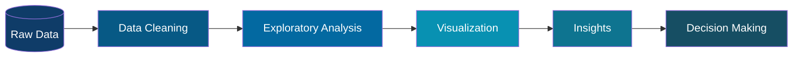

<!-- ========================================================= -->
<!--              KAUSHAL KUMAR | GITHUB PROFILE                 -->
<!-- ========================================================= -->

<div align="center">

<!-- ANIMATED HEADER -->


<!-- TYPING ANIMATION -->


<br/>

<a href="https://github.com/kaushalkumar123456">

</a>
<a href="https://www.linkedin.com/in/kaushal-kumar-21749826b/">

</a>
<a href="mailto:realkaushal365@gmail.com">

</a>

<br/><br/>


</div>

---

<!-- ABOUT -->
<h2 align="center">👨‍💻 ABOUT ME</h2>


```yaml
Name: Kaushal Kumar
Location: India 🇮🇳

Primary: Data Analytics
Secondary: Machine Learning
Also: Software Development

Currently:
  - Exploring and analyzing data
  - Building insightful dashboards
  - Learning machine learning
  - Improving programming skills

Goal: Transform data into decisions.
```

- 📊 Passionate about **Data Analytics & Visualization**
- 🧹 Interested in data cleaning, exploration and uncovering patterns
- 📈 Building dashboards and data-driven reports
- 🤖 Exploring predictive analytics and machine learning
- 💻 Using Python to solve practical problems
- 🌱 Always learning, experimenting and building

<br clear="both"/>

---

<!-- CAREER FOCUS -->
<h2 align="center">🎯 MY CORE FOCUS</h2>

<div align="center">

<table>
<tr>
<td align="center" width="33%">


<h3>📊 DATA ANALYTICS</h3>

Data Cleaning<br/>
Exploratory Analysis<br/>
SQL<br/>
Dashboards<br/>
Business Intelligence<br/>
Data Storytelling

</td>

<td align="center" width="33%">


<h3>🤖 MACHINE LEARNING</h3>

Predictive Modeling<br/>
Feature Engineering<br/>
Regression<br/>
Classification<br/>
Model Evaluation<br/>
Deep Learning

</td>

<td align="center" width="33%">


<h3>💻 SOFTWARE DEV</h3>

Python Programming<br/>
Problem Solving<br/>
Database Integration<br/>
Git & GitHub<br/>
Automation<br/>
Development

</td>
</tr>
</table>

</div>

---

<!-- ANALYTICS LAB -->

<!-- ================ DATA ANALYTICS LAB ================= -->

<h2 align="center">📊 DATA ANALYTICS LAB</h2>

<p align="center">

</p>

<table width="100%">
<tr>

<td width="33%" valign="top">

<h3>🐍 Python Analytics</h3>

- Python
- Pandas
- NumPy
- Data Cleaning
- Data Manipulation
- Exploratory Analysis

</td>

<td width="33%" valign="top">

<h3>📈 Business Intelligence</h3>

- Power BI
- Tableau
- Excel
- KPI Dashboards
- Business Reporting
- Data Storytelling

</td>

<td width="33%" valign="top">

<h3>🗄️ SQL & Databases</h3>

- SQL
- MySQL
- MongoDB
- Joins & Subqueries
- Filtering & Aggregation
- Database Management

</td>

</tr>

<tr>

<td width="33%" valign="top">

<h3>📊 Visualization</h3>

- Matplotlib
- Seaborn
- Plotly
- Charts & Graphs
- Interactive Visuals
- Statistical Plots

</td>

<td width="33%" valign="top">

<h3>📑 Excel Analytics</h3>

- Data Analysis
- Pivot Tables
- Data Cleaning
- Charts
- Reporting
- Spreadsheet Analytics

</td>

<td width="33%" valign="top">

<h3>🧠 Statistical Analysis</h3>

- Descriptive Statistics
- Correlation Analysis
- Trend Analysis
- Distribution Analysis
- Pattern Discovery
- Insight Generation

</td>

</tr>
</table>

<p align="center">


</p>


<!-- TECH STACK -->
<h2 align="center">⚙️ TECHNOLOGY STACK</h2>

<h3 align="center">📊 Data Analytics — Primary Stack</h3>

<div align="center">


</div>

<h3 align="center">🤖 Machine Learning</h3>

<div align="center">


</div>

<h3 align="center">💻 Software & Tools</h3>

<div align="center">


</div>

---

<!-- WORKFLOW -->
<h2 align="center">🔬 MY DATA WORKFLOW</h2>

<div align="center">



</div>

---

<!-- PROJECTS -->
<h2 align="center">🚀 PROJECT SHOWCASE</h2>

<div align="center">


</div>

<table>
<tr>
<td width="50%" valign="top">

### 📊 Data Analytics Projects

Data-driven projects focused on:

- Data cleaning
- Exploratory analysis
- Trend discovery
- Visualization
- Business insights

**Tools:** Python · SQL · Excel · Power BI

</td>
<td width="50%" valign="top">

### 📈 Dashboard Projects

Interactive reports for:

- KPI tracking
- Performance monitoring
- Business reporting
- Data-driven decisions

**Tools:** Power BI · Tableau · Excel

</td>
</tr>

<tr>
<td width="50%" valign="top">

### 🤖 Machine Learning Projects

Experiments and projects exploring:

- Predictive models
- Classification
- Regression
- Model evaluation

**Tools:** Scikit-learn · TensorFlow

</td>
<td width="50%" valign="top">

### 💻 Python Development

Programming projects involving:

- Automation
- Problem solving
- Data processing
- Application logic

**Tools:** Python · SQL · MongoDB

</td>
</tr>
</table>

<div align="center">

<a href="https://github.com/kaushalkumar123456?tab=repositories">

</a>

</div>

> 📌 Pin your best **3–6 projects** on your GitHub profile so visitors can quickly find your strongest work.

---

<!-- MACHINE LEARNING -->
<h2 align="center">🤖 MACHINE LEARNING CORNER</h2>

<div align="center">


</div>

```python
# My machine learning learning pipeline

import pandas as pd
from sklearn.model_selection import train_test_split
from sklearn.preprocessing import StandardScaler
from sklearn.metrics import accuracy_score

# 1. Prepare and explore data
# 2. Clean and preprocess
# 3. Engineer features
# 4. Train a model
# 5. Evaluate performance
# 6. Improve and iterate

print("Learning. Experimenting. Improving. 🚀")
```

**Areas I explore:**

- Regression & Classification
- Feature Engineering
- Data Preprocessing
- Model Evaluation
- Scikit-learn
- TensorFlow

---

<!-- GITHUB STATS -->
<h2 align="center">📊 GITHUB ANALYTICS CENTER</h2>

<div align="center">


<br/>


<br/>


<br/>


</div>

---

<!-- SNAKE ANIMATION -->
<h2 align="center">🐍 CONTRIBUTION SNAKE</h2>

<div align="center">


</div>

---

<!-- CONNECT -->
<h2 align="center">🌐 LET'S CONNECT</h2>

<div align="center">

<a href="https://www.linkedin.com/in/kaushal-kumar-21749826b/">

</a>

<a href="mailto:realkaushal365@gmail.com">

</a>

<a href="https://github.com/kaushalkumar123456">

</a>

</div>

---

<!-- FOOTER -->
<div align="center">


<br/>


**"Explore the data. Discover the story. Create the impact."** 💙

</div>
